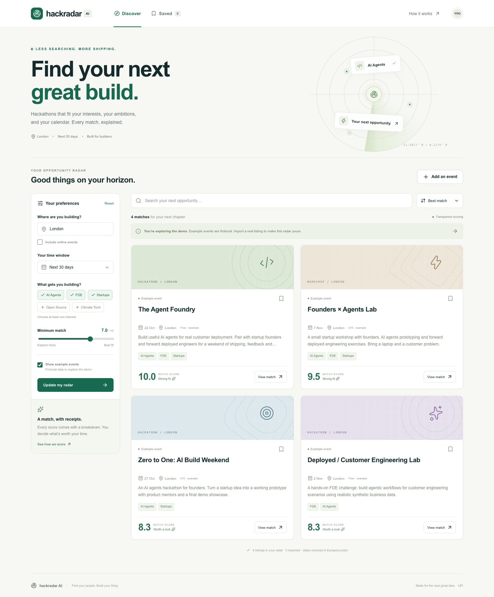

# HackRadar AI

**Find your next great build.** A personal hackathon radar that turns scattered event listings into an explainable shortlist and a practical preparation plan.

Repository: [ln-lai/hackradar-ai](https://github.com/ln-lai/hackradar-ai)

Next.js 16 · React 19 · TypeScript · Python / FastAPI · SQLite · optional xAI Grok

Built for a developer looking for **AI Agents, FDE and startup hackathons in London, within the next 30 days, scoring at least 7/10**. Those preferences are editable, and every score has receipts.



> **Data honesty:** All nine built-in events are fictional examples, clearly labeled in the interface. Dates are relative to the current London day so the demo remains useful. No real event has been preloaded or independently verified. Public URL imports retain their source and retrieval time; JSON imports are labeled user-supplied and unverified. No background web search or scheduled crawl runs in this MVP.

## Quick start

Requirements: **Node.js 24**, **pnpm 11.25.0**, **Python 3.12**. No API key, cloud account or database service is required.

```bash
# From the repository root
python3.12 -m venv .venv
source .venv/bin/activate
python -m pip install -r backend/requirements.lock.txt

# If pnpm is not installed: npm install -g pnpm@11.25.0
pnpm install --frozen-lockfile
bash scripts/dev.sh
```

Open **http://127.0.0.1:3000**. API documentation: **http://127.0.0.1:8000/docs**. Stop both services with Ctrl+C. On this prepared Mac, double-click **Start HackRadar.command** to launch the same demo.

Alternatively, use separate terminals:

```bash
# Terminal 1
.venv/bin/python -m uvicorn backend.app.main:app --reload --host 127.0.0.1 --port 8000

# Terminal 2
pnpm dev
```

On Windows, use `.venv\Scripts\python.exe` instead of `.venv/bin/python` and run the two services separately. The convenience shell scripts target macOS/Linux.

## What works

- A responsive discovery dashboard with location, date, interests, minimum score and online-event filters.
- Honest example, public-import and user-import labels; originals and retrieval timestamps in event details.
- Explainable matching with per-dimension evidence, search and sorting.
- Saved events and preferences persisted in browser storage.
- Public event URL import, authorized JSON import, and transactional deduplication.
- A local preparation brief and application starter, with optional Grok generation.
- SQLite persistence for imports, validation, request-size limits and optional server API token.
- Backend unit/integration tests, browser smoke tests, pinned dependencies and GitHub Actions.

## A 90-second demo

1. Open the dashboard. The default London / 30-day / 7+ view contains **four fictional matches**.
2. Open **The Agent Foundry → View match**. Inspect its 10/10 breakdown and explicit fictional-data notice.
3. Click **Generate local brief**. See a preparation checklist and an application starter that leaves placeholders for your own skills.
4. Save an event, open **Saved**, then reload: the bookmark remains in this browser.
5. Enable **Include online events** and update your radar: **Global Agents Sprint** appears. Change sorting or search for a title.
6. Turn off **Show example events**: the initial empty state honestly reflects that no real events are loaded.
7. **Add an event** from a supported public page or authorized JSON export. Import it twice to demonstrate deduplication. Current filters still apply.

For a short pitch and walkthrough, see [docs/DEMO.md](docs/DEMO.md). Chinese setup notes are in [docs/QUICKSTART.zh-CN.md](docs/QUICKSTART.zh-CN.md).

## How matching works

The score is **reproducible rules, not an opaque LLM estimate**. Grok is optional and generates prose; it never changes the arithmetic. This makes the MVP useful without credentials and auditable with them.

| Dimension | Maximum | Evidence |
| --- | ---: | --- |
| Interests | 5.0 | Equal share per selected interest, matched against explicit phrases in title, description and tags |
| Location | 2.5 | Exact city match, ignoring case/outer whitespace; 2.0 for online/hybrid attendance when enabled |
| Timing | 1.5 | Start date is within the selected London calendar window |
| Build format | 1.0 | Hackathon 1.0; workshop 0.5; meetup 0.25 |

The displayed total is rounded to one decimal. The selected threshold is inclusive (`>=`). Location and date are also hard filters: an out-of-town event cannot sneak in on points alone. Dates include today and `today + days`, in **Europe/London**, with daylight saving handled by `zoneinfo`. Events that started before today are excluded even if still ongoing; same-day events remain visible. Example visibility is a hard filter too.

Interest aliases are versioned in `backend/app/scoring.py`. For example, FDE includes “forward deployed”, “customer deployment” and “customer engineering”. Matching uses phrase boundaries. It does **not** understand negation, infer experience, guarantee event quality or confirm ticket availability. This limitation is displayed in the UI.

## Importing legitimate public data

### Public URL

Use **Add an event → Public event link**. The backend accepts HTTPS event pages on an explicit allowlist of Luma, Eventbrite and MLH hosts, reads `robots.txt`, and extracts **schema.org Event JSON-LD** from the returned HTML. It follows only supported HTTPS redirects, checks the destination's robots policy, limits page size and time, and skips cancelled/postponed or incomplete events.

This is a **best-effort structured-page importer**, not a universal crawler or an official platform integration. Login-gated pages, bot-blocked pages, missing JSON-LD, date-only/ambiguous dates, or robots exclusions produce a useful error. There is no CAPTCHA bypass, private Discord/LinkedIn scraping, or invented fallback event. Price remains “See organizer page” unless supplied by a user; availability and eligibility must be checked on the original page. Only import material you are authorized to use.

### JSON

Paste this shape into the JSON import tab, replacing every placeholder with an actual authorized listing. Use an ISO datetime **with a timezone offset** and a real organizer URL. Maximum 100 events / 1 MB per request.

```json
{
  "events": [
    {
      "title": "Replace with the actual event title",
      "description": "Replace with the public listing text and relevant themes.",
      "start_at": "2026-11-01T10:00:00+00:00",
      "end_at": "2026-11-01T18:00:00+00:00",
      "city": "London",
      "venue": "Replace with the venue",
      "url": "https://example.com/replace-with-real-listing",
      "organizer": "Replace with the organizer",
      "format": "in_person",
      "kind": "hackathon",
      "tags": ["AI Agents", "FDE", "Startups"],
      "cost": "See organizer page"
    }
  ]
}
```

User data cannot promote itself to “public import”. JSON imports stay **unverified**, and are not presented as independently retrieved facts. HTML is displayed as plain text; no imported markup is executed.

Deduplication uses canonical URLs (tracking parameters and fragments removed) **or** normalized title + London date + city. It preserves source links and URL aliases in an SQLite transaction. Existing details are retained rather than silently overwritten. Different sessions of the same series on one shared URL may merge; one event-specific URL per occurrence is recommended. Examples live separately and cannot overwrite your imports.

## Optional Grok

```bash
cp .env.example .env.local
cp .env.example backend/.env
```

In `backend/.env`, set `XAI_API_KEY` and `XAI_MODEL` to a model available in your xAI account. Restart the backend and refresh the page. The **Generate with Grok** button will become available.

- Calls `https://api.x.ai/v1/responses` with structured JSON output and `store: false`.
- Sends only the selected listing, selected preferences and computed score when you click the Grok button; API charges may apply.
- Treats source text as untrusted input, validates returned fields, and renders plain text.
- Falls back visibly to the local template on missing configuration, provider errors or invalid output.
- Uses server-only secrets. Never put keys in `NEXT_PUBLIC_*`, source files or committed JSON.
- Live provider calls require your key and supported model; automated tests mock the contract and failure path.

For an internal backend token, set the same `HACKRADAR_API_TOKEN` in `.env.local` and `backend/.env`, then restart both services. It protects direct API access but **does not authenticate visitors to the frontend**.

## Architecture & storage

```text
Browser (preferences + saved IDs in localStorage)
   → Next.js App Router / same-origin API proxy (server secrets)
      → FastAPI (validation, filters, scoring, imports, briefs)
         → SQLite (imported events + canonical URL aliases)
         → Allowed public event pages (explicit import only)
         → xAI Responses API (explicit opt-in brief only)
```

`backend/data/hackradar.sqlite3` is created on first run and ignored by Git. Configure `DATABASE_PATH` to change it. Run commands from the repository root so relative paths are stable. Built-in fixtures are generated in memory using the London date. There is **no Supabase dependency or incomplete Supabase adapter**; SQLite is the working MVP store. Supabase/Postgres, authentication and multi-user isolation are future extensions.

| Path | Purpose |
| --- | --- |
| `app/` | Next.js UI and server-side API proxy |
| `lib/types.ts` | Frontend contract and API client |
| `backend/app/` | Models, scoring, seeds, SQLite, public import, Grok briefs |
| `backend/tests/` | Backend tests without real web or LLM calls |
| `tests/` | Playwright user journeys |
| `docs/` | Demo, publishing and setup notes |
| `.github/workflows/ci.yml` | Python tests, build, TypeScript and browser checks |

## Checks

```bash
.venv/bin/python -m pytest -q
pnpm build
pnpm typecheck
pnpm exec playwright install chromium
pnpm test:e2e
```

Browser tests can use installed Chrome instead: `CHROME_PATH="/path/to/chrome" pnpm test:e2e`. They start isolated services on ports **3001/8001** with a fresh temporary database for every run; existing personal demo data is never reused. Tests cover score evidence, timezone boundaries, hard filters, deduplication and concurrency, provenance, invalid imports, robots/URL restrictions, size limits, optional auth, Grok fallback, JSON import/re-import, saved state and mobile layout.

With the demo running on port 3000, `node scripts/capture-demo.mjs` captures desktop and mobile screenshots for this README (supports `CHROME_PATH` too).

## Deployment & GitHub

See [docs/PUBLISHING.md](docs/PUBLISHING.md) for repository and deployment guidance. `pnpm build && pnpm start` serves the production frontend; run FastAPI separately and set `BACKEND_URL` to its private address.

This is a **single-user local MVP**. Before an internet-facing deployment with imports or paid Grok enabled, add user authentication, request quotas/rate limits, database isolation and appropriate access controls. The Next.js proxy is not a login system, and multiple visitors otherwise share imported records. Do not expose the local ports directly to the internet. A static-only host cannot run the Python service; host Next.js and FastAPI on compatible services or a controlled server. Remote provider connectivity and public-page access vary by host.

## Design references & limits

- [Next.js installation](https://nextjs.org/docs/app/getting-started/installation)
- [FastAPI documentation](https://fastapi.tiangolo.com/)
- [schema.org Event](https://schema.org/Event)
- [xAI Responses API](https://docs.x.ai/developers/rest-api-reference/inference/responses)

No scheduled notifications, automatic application submission, GitHub-profile inference, team matching or production Supabase integration are claimed. Those are clear next steps, after testing this workflow with real users.

MIT licensed. See [LICENSE](LICENSE).
